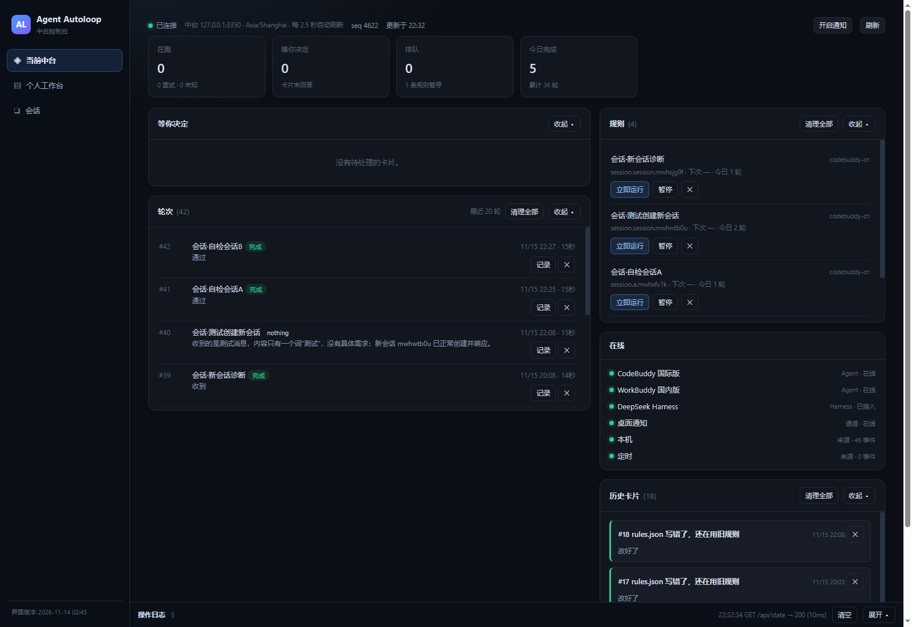
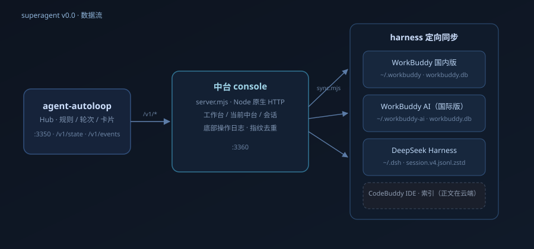

<div align="center">

# superagent

**把散落在各个 Agent 里的活儿，收进一个中台**

[](https://github.com/Yangxiaolongismygirl/superagent/releases/tag/v0.0)
[](https://nodejs.org)
[](#快速开始)
[](LICENSE)
[](#)

一个跑在本机的 Agent 自动化中台：定义规则、派活给 CodeBuddy / WorkBuddy / DeepSeek Harness，
把每一轮的输入输出、会话、产物全部留痕，并把会话同步回对应的 harness。

</div>



---

## 目录

- [它解决什么问题](#它解决什么问题)
- [功能一览](#功能一览)
- [架构](#架构)
- [快速开始](#快速开始)
- [界面说明](#界面说明)
- [会话同步](#会话同步)
- [目录结构](#目录结构)
- [v0.0 的边界](#v00-的边界)
- [路线图](#路线图)
- [License](#license)

---

## 它解决什么问题

同时用好几个 Agent 工具的人，都会遇到同一组麻烦：

| 痛点 | 具体表现 | superagent 的做法 |
|---|---|---|
| 活儿散在各处 | 一会儿在 CodeBuddy，一会儿开 WorkBuddy，记不清哪个跑完了 | 统一「规则 → 轮次」视图，一眼看到在跑 / 排队 / 已完成 |
| 干了什么说不清 | 跑完只有一句"已完成"，没有产物、没有依据 | 每轮落地 `context.json`、会话原文、产物清单、思维链 |
| 会话找不回来 | 换工具就看不到之前的上下文 | 会话列表聚合多个 harness，可续派、可导入 |
| 出问题没法查 | 界面上点了一下，背后发生了什么完全不知道 | 底部操作日志：每个接口调用带状态码和耗时 |

## 功能一览

<table>
<tr><td width="50%" valign="top">

**工作台**

- 卡片式决策：要你拍板的事集中在一处
- 一键"允许 / 驳回 / 改主意"，决策回写 hub
- KPI：等你 / 在跑 / 排队 / 今天做完

**当前中台**

- 规则列表：下次触发时间、暂停、跳过、立即跑
- 轮次列表：状态、耗时、摘要、产物
- 「在线」栏：Agent / 通道 / 来源，谁在线一眼看到

</td><td width="50%" valign="top">

**会话**

- 按 Agent 分组，支持搜索
- 详情：用户/助手消息、工具调用、产物、思维链
- 续派：直接在原会话里接着派活
- 重命名、归档、导入到指定项目

**运维**

- 底部操作日志，可展开 / 收起 / 清空
- `verify.mjs` 五层自检，改完先自己验
- 指纹去重，数据没变不重绘，界面不闪

</td></tr>
</table>

## 架构



三层，各管各的：

| 层 | 职责 | 实现 |
|---|---|---|
| **Hub** | 规则装载、事件路由、轮次调度、卡片投影 | `agent-autoloop`（外部依赖，跑在 `:3350`） |
| **中台** | 人看的界面 + 把操作翻译成 hub 调用 | `console/server.mjs`（Node 原生 HTTP，零依赖） |
| **同步** | 把中台会话镜像进各 harness 的存储 | `console/sync.mjs` + `console/dsh-sync.mjs` |

## 快速开始

**前置**：Node ≥ 22（用到 `node:sqlite` 和 `node:zlib` 的 zstd）、一个跑着的 `agent-autoloop` hub。

```bash
# 1. 起中台
cd console
node server.mjs
# → Console ready: http://127.0.0.1:3360

# 2. 自检（语法 / 接口 / 快照契约 / 渲染 / 界面）
node verify.mjs

# 3. 会话同步（常驻，server 启动时会自动带起）
node sync.mjs --watch
```

Windows 下还可以直接双击 `启动控制台.cmd`，或用 `start-hidden.ps1` 静默启动。

**配置**：中台读 hub 的 `config.json` 取 `source.key`；规则文件在 `%USERPROFILE%\.agent-autoloop\rules.json`。

## 界面说明

三个页签，加一条常驻底栏。

### 会话


- 顶部搜索：输入关键词回车，匹配会话正文
- 每个分组右上角有「新增会话」，带「可续接」标记的是 ACP Agent
- 行内三个动作：重命名 ✎ / 导入到项目 ⇥ / 归档 🗑

### DeepSeek Harness 分组


dsh 的会话是 **zstd 压缩的 JSONL**，中台直接解压读取，所以它能和本地 Agent 排在同一张列表里；
分组带「新建会话」，写进去的是 dsh 自己的 v4 格式。

### 底部操作日志

所有 `/api/*` 调用都会留一条：方法、路径、状态码、耗时。

```
操作日志 42                    17:52:31 GET /api/state → 200 (12ms)         清空  展开 ▴
```

保留最近 300 条（`localStorage`），刷新不丢。

## 会话同步

`sync.mjs` 每 5 秒比对会话文件字节数，**变了就整份重推**。判据很土但可靠：有新内容，文件一定变长。

**定向同步**——会话属于谁，就只写谁：

| 会话来自 | 落到 | 具体位置 |
|---|---|---|
| WorkBuddy 国内版 | `~/.workbuddy` | `projects/<cwd>/<id>.jsonl` + `workbuddy.db` 的 `sessions` |
| CodeBuddy 国际版 | `~/.workbuddy-ai` | 同上 |
| DeepSeek Harness | `~/.dsh` | `sessions/--<cwd>--/session-<id>/session.v4.jsonl.zstd` |

早期版本是"全量推三个"，结果国内版的会话会在 dsh 里冒出来——现在不会了。

**续接语义**：同一个会话再派活，`created_at` 保留首次的值，只更新 `updated_at` 和内容，不会新建会话。

## 目录结构

```
superagent/
├── console/
│   ├── server.mjs            # 中台服务（HTTP + 静态资源 + 全部 API）
│   ├── sync.mjs              # 会话同步 worker
│   ├── dsh-sync.mjs          # DeepSeek Harness 适配器（读写 zstd v4）
│   ├── verify.mjs            # 五层自检
│   ├── smoke.mjs             # 假 DOM 渲染自检
│   ├── cdp.mjs               # 极简 CDP 客户端（连 Electron 调试端口）
│   ├── public/
│   │   ├── index.html        # 页面骨架 + 样式
│   │   └── app.js            # 全部前端逻辑
│   ├── 启动控制台.cmd
│   └── start-hidden.ps1
└── docs/
    └── images/
```

## v0.0 的边界

写清楚，免得误会：

- **CodeBuddy IDE 只能列出会话，正文拿不到**。它是 VS Code 分支，对话内容由云端 agent 服务持有，本地只有索引；我们把索引写进去了，正文服务端没有，所以点开是空的。
- **dsh 的新会话要重启它才看得到**。它启动时扫描会话目录并缓存，外部写入的目录需要重启后才会出现在列表。
- **同步是整份重写**，不是增量追加。harness 侧的 `updated_at` 每次刷新，会话会被顶到列表前面。
- **只验证过 Windows**。路径处理、GBK 批处理、`%APPDATA%` 结构都是按 Windows 写的。

## 路线图

- [ ] 把 hub 也收进仓库，做成一键启动
- [ ] 会话同步改成增量追加，避免列表置顶
- [ ] 支持 Linux / macOS 的 harness 路径
- [ ] 中台内直接查看 dsh 会话的思维链

## License

[MIT](LICENSE) © 2026 Yangxiaolongismygirl
