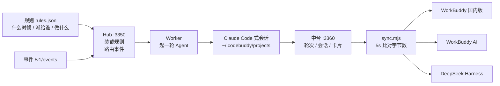
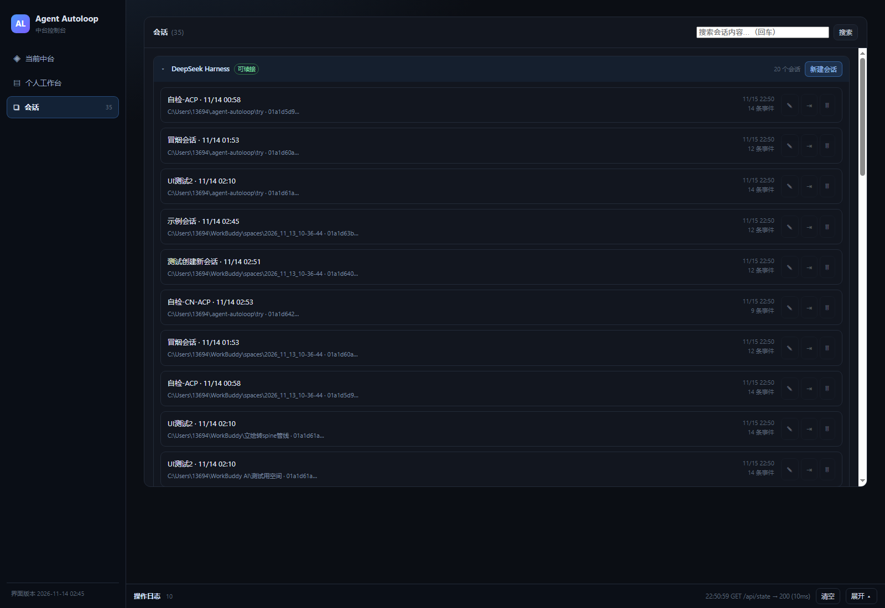

# superagent · Agent 自动化中台

**一个窗口管住所有 Agent 的活儿：写规则 → 派给 CodeBuddy / WorkBuddy / DeepSeek Harness → 每一轮都有据可查 → 会话同步回对应的 harness。**

不用来回切三个客户端，不用翻聊天记录找"上次那个任务跑完没有"，也不用担心会话只活在某个工具里。


> **30 秒上手**：装好 Node 22+ 和一个跑着的 `agent-autoloop` hub → `cd console && node server.mjs` → 浏览器打开 `http://127.0.0.1:3360` → 在「当前中台」写规则，或在「会话」里点「新增会话」写一句话。
> 界面上会看到它排队、开跑、产出结果；会话会同时出现在对应 harness 的列表里。

---

## 它替你省掉的四个坑

| 原来的坑 | 现在 |
|---|---|
| 三个 Agent 客户端各开一个窗口，跑没跑完得挨个点开看 | **一个「当前中台」全看完**：在跑 / 排队 / 等你 / 已完成，连下次触发时间都在行上 |
| 跑完只回一句"已完成"，产物在哪、依据是什么全不知道 | 每轮落 `context.json`，会话原文、产物清单、思维链全能在会话详情里翻 |
| 会话只在某个工具里，换台机器/换个客户端就"没了" | **按 Agent 定向同步**：国内版的会话进 `.workbuddy`，国际版进 `.workbuddy-ai`，dsh 进 `.dsh` |
| 界面上点了一下没反应，也不知道是没发出去还是后端挂了 | 底部**操作日志**：每个 `/api/*` 调用都带状态码和耗时，展开就能看 |

---

## 数据怎么流



三段各管各的：**Hub** 只管调度，**中台**只管给人看和把点击翻译成调用，**同步**只管把会话落到对应 harness 的存储里。

---

## 中台长什么样

### 会话页：按 Agent 分组，能续派



- 顶部搜索框回车，匹配会话**正文**（不只是标题）
- 带「可续接」标记的是 ACP Agent，可以在原会话里直接接着派活
- 行内三个动作：重命名 ✎ / 导入到项目 ⇥ / 归档 🗑

### DeepSeek Harness 也在同一张列表里


dsh 的会话是 **zstd 压缩的 JSONL**（`session.v4.jsonl.zstd`）。中台直接解压读取，所以它和本地 Agent 排在一起；
分组右上角的「新建会话」写进去的就是 dsh 自己的 v4 格式，不是伪造的文本。

### 底部操作日志

```
操作日志 42                    17:52:31 GET /api/state → 200 (12ms)          清空  展开 ▴
```

所有 `/api/*` 调用自动留痕（方法、路径、状态码、耗时），保留最近 300 条，刷新不丢。

---

## 只需要填三样

| 字段 | 填什么 | 说明 |
|---|---|---|
| **派给谁** | CodeBuddy 国际版 / WorkBuddy 国内版 / DeepSeek Harness | 传显示名或 id 都认，内部会校验 |
| **会话名字** | 比如「主城灯光检查」 | 会成为规则名，也是 harness 里的会话标题 |
| **要做的事** | 一句话需求 | **这句话会原样出现在会话的第一条消息里** |

> 工作目录不用手填，默认落在最近用过的项目上；模型不填就用 Agent 的默认。

---

## 会话落到哪

同步不是"全推三个"，而是**谁的就写谁的**——早期版本全量推，导致国内版的会话在 dsh 里冒出来，这个问题已经修掉。

| 会话来自 | 落到 | 路径 |
|---|---|---|
| WorkBuddy 国内版 | `~/.workbuddy` | `projects/<cwd>/<id>.jsonl` + `workbuddy.db` 的 `sessions` 表 |
| CodeBuddy 国际版 | `~/.workbuddy-ai` | 同上 |
| DeepSeek Harness | `~/.dsh` | `sessions/--<cwd>--/session-<id>/session.v4.jsonl.zstd` |

同步的判据很土但可靠：**会话文件字节数变了就整份重推**，5 秒一轮。

**续接语义**：同一个会话再派活，`created_at` 保留首次的值，只更新 `updated_at` 和内容，不会新建一条。

---

## 环境要求

| 依赖 | 要求 | 说明 |
|---|---|---|
| 系统 | Windows 10 / 11 | 路径处理、批处理编码、`%APPDATA%` 结构都按 Windows 写的 |
| Node | ≥ 22 | 用到 `node:sqlite` 和 `node:zlib` 的 zstd；零第三方依赖 |
| agent-autoloop | 跑在 `:3350` | 中台是它的界面层，不内嵌 hub |
| 浏览器 | Edge / Chrome 较新版本 | 只需要支持 `backdrop-filter` 和 CSS 变量 |
| DeepSeek Harness（可选） | 已安装 | 不装只是没有 dsh 分组 |

---

## 已跑通的量

| 项 | 结果 |
|---|---|
| 自检脚本 `verify.mjs` | 15 项，13 通过 / 2 跳过（无头浏览器 dump-dom 这台机器起不来） |
| 会话同步 | 国内版 / 国际版 / dsh 三条链路各自端到端跑通，续派后 harness 侧能看到新内容 |
| 新建会话 | 连续建 5 个（含中文名、单字名），规则全部落盘，会话全部出现 |
| 会话读取 | 中台 30+ 条、dsh 5 条（zstd 解压），详情页正文完整 |

---

## 从源码跑起来

```bash
cd console
node server.mjs        # → http://127.0.0.1:3360
node verify.mjs        # 五层自检：语法 / 接口 / 快照契约 / 渲染 / 界面
node sync.mjs --watch  # 会话同步（server 启动时会自动带起）
```

Windows 下也可以直接双击 `启动控制台.cmd`，或用 `start-hidden.ps1` 静默启动（配计划任务开机自启）。

---

## 常见问题

**Q：新建会话报「规则没被中台接管」？**
说明 `rules.json` 写完但 hub 没装载成功。中台现在用「临时文件 + rename」原子写，并轮询确认；还报这个错，检查是不是有别的程序在改同一个文件。

**Q：新建了会话，会话页半天没有？**
会话文件要等**第一轮跑完**才产生（约 30–60 秒）。页面每 5 秒自动拉一次，跑完会自己出现。

**Q：harness 里点开是空的？**
CodeBuddy IDE 是例外——它是 VS Code 分支，对话正文在云端，本地只有索引，导入后能列出条目但正文为空。WorkBuddy 两个版本和 dsh 都是本地存储，正常有正文。

**Q：dsh 里看不到刚推过去的会话？**
dsh 启动时扫描会话目录并缓存，外部写入的目录要**重启 dsh** 才看得到。另外它的会话按工作区分组，切到对应的那个工作区才会显示。

**Q：界面每秒闪一下？**
已经修了：现在用数据指纹去重，内容没变就不重建 DOM。还闪的话 Ctrl+F5 强刷一次拿新前端。

---

## 版本

### v0.0

首个可用版本。

- 三视图：工作台（卡片决策）/ 当前中台（规则 + 轮次）/ 会话（分组 + 详情 + 续派）
- 会话导入与定向同步：WorkBuddy 国内版、WorkBuddy AI、DeepSeek Harness
- dsh 适配器：zstd v4 的读写，能在中台里新建 dsh 会话
- 底部操作日志、五层自检脚本、指纹去重
